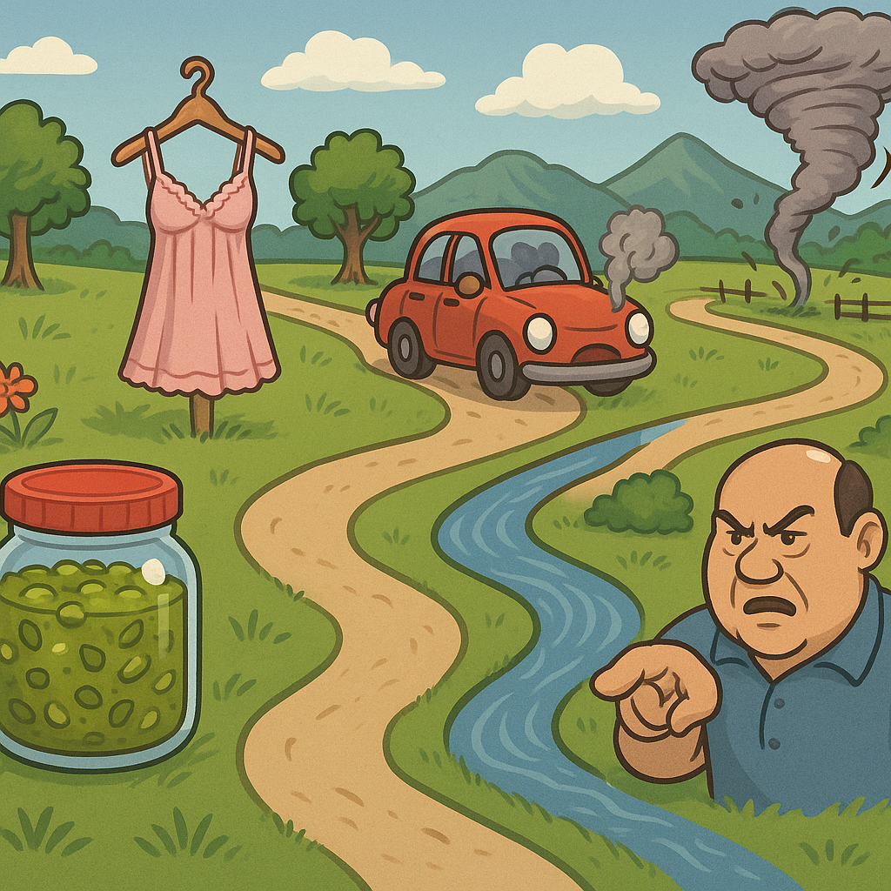
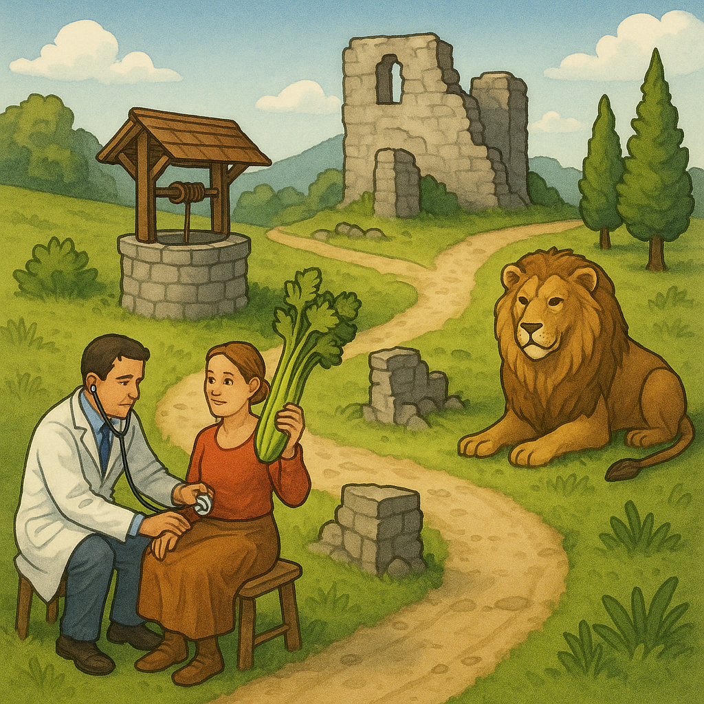

# word2img

Generate an image from a list of words using OpenAI's `gpt-image-1` model. Useful for remembering lists of words. 

## Requirements

- Python 3.10+

## Install

```bash
pip install -e .
```

## API usage

```python
from word2img import words_to_img

result = words_to_img(["frog", "does", "dancing"], api_key="your_api_key")
with open("frog-does-dancing.png", "wb") as f:
    f.write(result["image_bytes"])
```

By default, `words_to_img(...)` uses the `loci` prompt style: one memory-palace scene with the words placed in order along a path.
Override with `prompt_type="normal"` for the original hyphen-joined prompt or `prompt_type="scene"` for a single surreal mnemonic scene.

## Norwegian sign-language GIFs

Install the optional GIF dependencies:

```bash
pip install -e ".[sign-language]"
```

```python
import word2img

word2img.sign_language(["Hei, hvordan går det?"]).write("greeting.gif")

# Or keep the result to inspect the selected signs:
result = word2img.sign_language(["Hei, hvordan går det?"])
result.write("greeting.gif")
print(result["signs"])  # Selected signs, including fingerspelling and word-form substitutions
```

Accepts either a sentence string or a list of strings, joined in order into **one
looping GIF**. No OpenAI API key is needed. The result contains `image_bytes`,
`mime_type` (`image/gif`), `text`, `signs`, and the dictionary `source` URL.
Its `.write(filename)` method accepts a string or `Path`, writes the GIF bytes,
and returns the destination `Path`. Existing files are overwritten; the parent
directory must already exist. Dictionary access such as `result["image_bytes"]`
is still supported.

Inspired by [lage_videoer_tegnspraak](https://github.com/oyvinrog/lage_videoer_tegnspraak),
this looks up Norwegian words and phrases in the
[Minetegn dictionary](https://www.minetegn.no/Tegnordbok-2016/) and joins its real
sign clips. It prefers phrase matches, then tries basic Norwegian word forms and
compound components before fingerspelling unknown words. These are heuristic
lookups, **not a translation into Norwegian Sign Language grammar**. Ambiguous
entries prefer exact labels, then unqualified variants; inspect `signs` to review
the choices. Words that cannot be signed or fingerspelled raise `ValueError`.

```python
result = word2img.sign_language(
    "Hei, takk!",
    size=(320, 240),     # Default: (480, 360); aspect ratio preserved with padding
    fps=10,              # Default: 15; lower values make smaller GIFs
    language_wash=False, # Disable word-form and compound heuristics
    cache_dir="sign-cache",
)
```

The optional `Pillow` and `imageio-ffmpeg` packages handle GIF encoding and video
decoding. On platforms supported by imageio-ffmpeg's bundled wheels (Windows,
macOS, Linux), no system FFmpeg installation or shell tools are needed. Other
architectures may require an FFmpeg executable via `IMAGEIO_FFMPEG_EXE`.

The first call needs internet access. The dictionary and downloaded clips are
cached in the OS user cache directory; repeated calls for cached signs work
offline. Use `refresh=True` to refresh the dictionary index, or
`dictionary="dictionary.xml"` to supply a local Minetegn XML index. Clip downloads
remain cached. Encoding holds frames in memory and defaults to a maximum of
1,800 frames; shorten the input, lower `fps`, or explicitly increase `max_frames`
for longer sequences. GIFs contain no audio. Minetegn retains rights to its
dictionary clips; check its terms for your intended redistribution.

To run all tests including video/GIF integration checks:

```bash
pip install -e ".[dev,sign-language]"
python -m pytest
```

### Sign-language CLI

```bash
python3 -m word2img.sign "Hei, hvordan går det?"
```

Saves `<sentence>.png` in the current directory using a filename-safe version of
the sentence. The PNG is animated (APNG), preserving the signs' motion and timing;
viewers without APNG support may show only the first frame. No API key is needed.
The same optional `sign-language` dependencies above are required.

Choose a filename, or request a GIF instead:

```bash
python3 -m word2img.sign "Hei, takk!" -o greeting.png
python3 -m word2img.sign "Hei, takk!" -o greeting.gif
```

Existing output files are overwritten; the parent directory must already exist.

## CLI usage

```bash
python -m word2img
```

Or choose a prompt style explicitly:

```bash
python -m word2img --prompt-type normal
```

You will be prompted for:
- Comma-separated words (for example `frog,does,dancing`)
- OpenAI API key on first run only (hidden input)

The CLI stores the API key in the system keyring and writes `<prompt>.png` to the current directory.

## EFF passphrase + image mnemonic

Generate an EFF-style passphrase using computer randomness, then generate an image for it:

```bash
python -m word2img.effgen
```

Or via installed script:

```bash
word2img-effgen
```

Options:
- `-n`, `--num-words`: number of words (default: `6`)
- `--mnemonic-mode`: `loci` (default) or `scene`
- `--lang`: translate the selected passphrase before generating the mnemonic image. Example: `--lang no` for Norwegian

On first run, the tool downloads and caches the official EFF large wordlist at `~/.cache/word2img/eff_large_wordlist.txt`.
Default mode is `loci`: one geographic memory-palace image with landmarks in strict passphrase order.
All modes explicitly instruct the model to avoid rendering any text/letters in the image.

## Examples

English `effgen` output:

Passphrase: `relish negligee exhaust sinuous browbeat twister`



Norwegian `effgen --lang no` output:

Passphrase: `diagnoser selleri mened ruiner løve rutine`



Passphrase: `stikkende utpressing uprøvd ubehag jubel utvikle`


